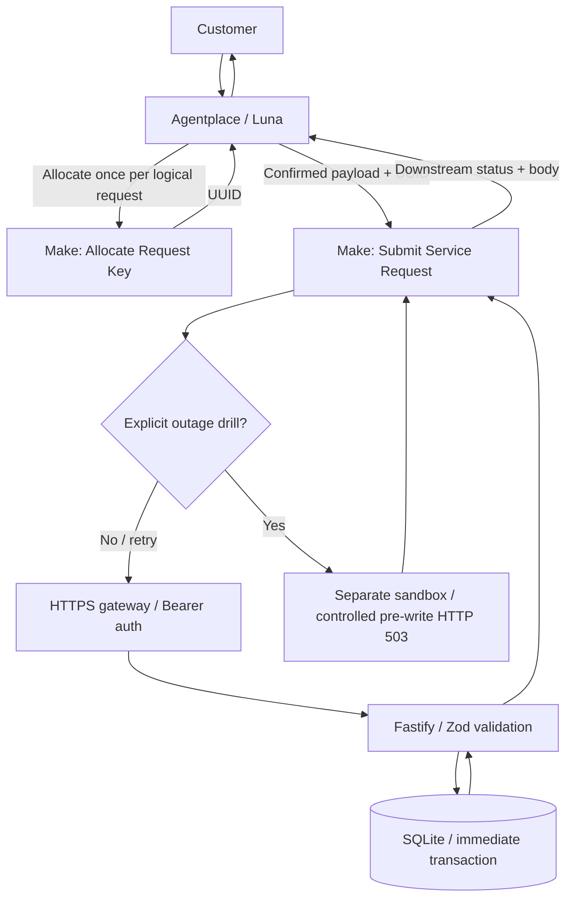

# SpokeWorks | Agentplace FDE integration

SpokeWorks is a bicycle-service demo agent built in Agentplace with Luna. It helps a customer choose one of five services, enter synthetic contact details and a preferred time, review the request, and explicitly submit it. The external TypeScript API registers test requests; it does not book appointments or contact real customers.

**Live demo:** https://frkr1utnuxoa.run.agentplace.io

## Architecture



The integration uses two Make scenarios: allocation (8819515) and submission (8819807). The submission router sends ordinary requests and retries to the final API, and only an explicit outage drill to the separate sandbox. The normal branch holds the Bearer credential in Make; the sandbox branch does not receive it. The agent retains the logical request key and payload for retries. The Make response maps the downstream status and body back to the agent so it can distinguish a receipt from a failure.

## Run locally

Requires Node.js 22 (verified with 22.23.2) and npm. If no native prebuilt binary is available for better-sqlite3, a compatible native build toolchain is also required. Port 3000 must be free.

```sh
git clone https://github.com/0mandrock1/agentplace-bike-api.git
cd agentplace-bike-api
npm ci
npm run check
npm test
npm start
```

The test script builds TypeScript before running the Node test runner. The server creates its SQLite database (agentplace.db) in the current working directory and listens on localhost:3000. The database, generated build output and local credentials are ignored by Git. Local requests do not require a token. The hosted deployment uses an HTTPS reverse proxy with Bearer authentication, a persistent SQLite database and systemd. Its fault-injection header is disabled/stripped. Hosted credentials are not part of this repository.

## API contract

| Method and path | Purpose |
| --- | --- |
| GET /health | Liveness |
| GET /v1/services | Five supported service identifiers |
| POST /v1/requests | Validate and register or replay a test request |

Example request (JSON):

```json
{
  "test": true,
  "service": "diagnostics",
  "customer": {
    "name": "Demo Rider",
    "email": "rider@example.com",
    "phone": "+12025550123"
  },
  "idempotency_key": "a1b8073d-4d79-4cfa-8abb-738202e9e9e2",
  "preferred_at": "2026-12-10T10:30:00-05:00"
}
```

Allowed services: diagnostics, basic_maintenance, puncture_repair, brake_adjustment, gear_adjustment. The request must explicitly set test to true, provide a UUID, a nonempty trimmed name (up to 120 characters), a synthetic email under example.com/net/org or a .test domain, a reserved fictional phone number (+12025550100 through +12025550199), and an ISO 8601 datetime with an offset (or Z). The time is a preference, not an availability check.

| HTTP status | Result |
| --- | --- |
| 201 | New receipt: request_id, status: received, replayed: false, test_only: true |
| 200 | Replay: same request_id, replayed: true |
| 409 | idempotency_conflict: same key, different validated payload |
| 422 | invalid_request: schema validation failed |
| 400 | Malformed JSON (invalid_request) |
| 401 | Missing or incorrect Bearer credential at hosted gateway |
| 503 | Controlled service-unavailable simulation (not an actual network incident) |
| 500 | Unexpected internal error |

## Reliability and data handling

One UUID identifies one logical request. The backend hashes a canonical representation of the validated payload using SHA-256 and uses the key as the SQLite primary key. An immediate transaction serializes the lookup and insert, so concurrent retries with the same key do not create a second row. Matching fingerprints replay the stored receipt; different fingerprints conflict. A new logical request receives a new key. This does not deduplicate different keys that happen to contain the same customer details.

The preferred time and service are stored with the receipt identifier, key, hash and creation time. Raw contact fields are not persisted in the final database. The hash is not encryption or a general anonymization guarantee; use synthetic contacts only. A failure is not a receipt. On explicit retry, reuse the original key and validated payload; never generate a fresh key merely because an acknowledgement was lost.

The local API supports two opt-in fault simulations: prewrite (503 before registration) and lost_ack (503 after a successful commit). The production-style demo API disables these hooks; the agent's outage drill instead uses the separate sandbox. The two paths are deliberately distinct.

## Reproduce the backend checks

Run the following from a second POSIX shell while the local server is running. The UUID is freshly generated for each run, not reused from the example.

```sh
key=$(node -e 'console.log(require("node:crypto").randomUUID())')
body=$(printf '{"test":true,"service":"diagnostics","customer":{"name":"Demo Rider","email":"rider@example.com","phone":"+12025550123"},"idempotency_key":"%s","preferred_at":"2026-12-10T10:30:00-05:00"}' "$key")
post() {
  curl -sS -i -H 'Content-Type: application/json' -d "$1" http://localhost:3000/v1/requests
  printf '\n'
}
post "$body"                                 # 201
post "$body"                                 # 200, same request_id
post "$(printf '%s' "$body" | sed 's/diagnostics/gear_adjustment/')" # 409
post '{}'                                    # 422
KEY="$key" node --input-type=module -e 'import Database from "better-sqlite3"; const db=new Database("agentplace.db",{readonly:true}); console.log(db.prepare("SELECT count(*) AS rows FROM requests WHERE idempotency_key=?").get(process.env.KEY)); db.close()'
# Expected: { rows: 1 }
```

For local fault testing, stop the local server and restart with `ENABLE_FAULT_INJECTION=true npm start`. Use a fresh UUID for each case. Send the same payload first with the additional header `x-test-fault: prewrite` (503, zero rows for the key), then without the header (201, one row). With another fresh UUID, send `x-test-fault: lost_ack` (503, one committed row), then resend without the header (200, same stored request_id and one row). The automated suite exercises both cases and persistence across database reopen. Never enable fault injection on a publicly accessible gateway.

## Acceptance matrix

Observed in Agentplace Preview on 2026-11-26. Backend journal and SQLite were checked independently of the agent's text. Identifiers below refer to synthetic test data.

| Scenario | Observed result | Evidence |
| --- | --- | --- |
| Successful submission | PASS: 201, receipt for gear adjustment | req-a, one row |
| Repeated submission | PASS: 201 then 200, same receipt | req-b / req-c, one row |
| Incomplete data | PASS: inline form errors, no final API call or row | Final row count remained 4 |
| Unavailable service | PASS: controlled sandbox 503, no registration | Sandbox attempt 76, not_processed |
| Recovery (extra) | PASS: explicit retry 201, same key as outage | req-d, one final row, zero sandbox rows for key |
| Normal Diagnostics after router change | PASS: 201, new UUID, matching receipt | req-e, one row; sandbox unchanged |

### Evidence from the observed run

| Correlation | Idempotency key | Request ID |
| --- | --- | --- |
| req-a (201) | 5797f43d-8563-4df0-a255-0283ba8ad277 | 64a391fb-a0f2-4195-abf3-58c045b29211 |
| req-b (201), req-c (200) | a1b8073d-4d79-4cfa-8abb-738202e9e9e2 | 22a3439c-73ef-4bad-b76e-616dfbe9ef10 |
| sandbox attempt 76 (503), req-d (201) | f940547c-0fdc-4145-816a-37c8cc1280bf | f438f43f-30d0-40b5-be47-6ea5ee41076f |
| req-e (201) | 7e875f7d-bc95-4e86-97ef-f4c613a8e80e | a1c2c35f-6ed6-40ed-9bf6-c1e0862e497d |

The hosted database contained five records after recovery (two earlier API smoke requests and three distinct agent requests), then six after the final Diagnostics regression at 10:45:55 UTC. The new receipt matches the preferred time 2026-11-26T15:43:00+02:00 and exactly one final database row. The sandbox contained 20 pre-existing records; the outage did not add one. These are recorded observations, not results of the local reproduction script. The source code and runnable tests are provided for independent verification.

## Agent review procedure

- Start a fresh conversation, choose a service, use synthetic contacts, review and submit. Expect one receipt.
- Request an explicit resend in the same conversation. Expect the same receipt, not a new appointment.
- Try an incomplete form. Expect validation and no final submission.
- Start a fresh request and explicitly choose the resilience drill. Expect a controlled 503; retry the same request normally and expect a receipt.

## Limitations and operational boundaries

- Demo only: no calendar availability, real appointment booking, CRM delivery, customer messaging or real personal data.
- The published agent URL returned HTTP 200 without authentication. The final normal Diagnostics submission was verified against the backend journal and SQLite; direct card-to-form navigation and an independent interactive run of the published version were not separately observed.
- The 503 drill is a controlled HTTP response from a separate sandbox, not a live network outage. Actual TCP timeouts and key retention across new conversations have not been demonstrated.
- Full payload identity across the sandbox failure and recovery was not independently verified (the rejected sandbox attempt stores no fingerprint). The same key and visible service/time were confirmed.
- Make execution history was not independently inspected; routing evidence comes from observed downstream responses and the recorded configuration. The incomplete-form result establishes no final API call, not absence of all Make activity.
- SQLite is a single-host demo persistence layer. Multi-host storage, sustained load, rate limiting, abuse controls, secret rotation, and operational retention policies require separate production design and validation. The local API is not intended to be exposed directly to the internet.
